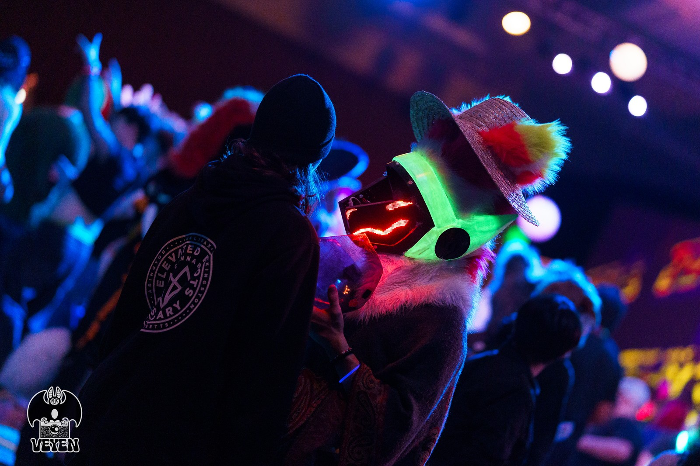
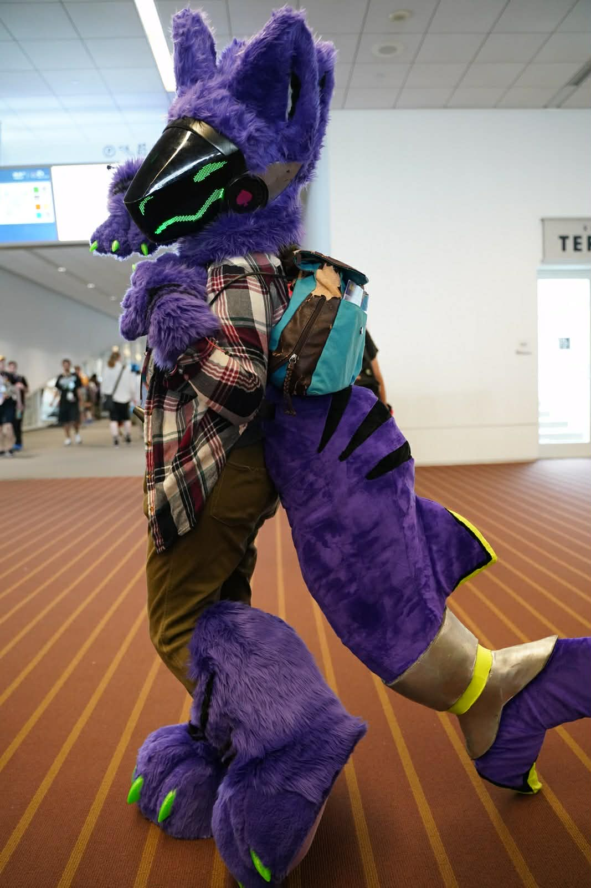

# Protogen Vector Drawer For Hub75 Matrix Panels

An open-source vector graphics rendering pipeline on RGB LED matrix panels, for use in protogen fursuit heads. Built for Raspberry Pi with a priority on performance and real-time rendering.

[What is a protogen?](https://knowyourmeme.com/memes/protogen)

---

## Features

- **Real-Time Rendering** - Converts vector graphics into expressions on an RGB matrix.
- **Material Overlay** - Layering geometry over images or GIFs for materials and future shader support.
- **Smooth Transitions** - Cubic-Bezier-curve, Linear and exponential interpolation between expression states.
- **Open Source** - Licensed under the GNU General Public License, version 3.
- **Cross-Platform Build** - CMake-based build system supports Linux (native + cross), NixOS, and Windows (native desktop).

---

## 🛠️ Setup

<details>
<summary>Raspberry Pi</summary>

```bash
# Update your System
sudo apt update -y && sudo apt upgrade -y
# Dependencies
sudo apt install cmake g++ pkg-config \
  libopencv-dev libboost-dev \
  libavcodec-dev libavformat-dev libavutil-dev \
  libswscale-dev libswresample-dev \
  libpng-dev libjpeg-dev libtiff-dev libwebp-dev \
  libdc1394-dev libtbb-dev libopenexr-dev
# Install the repo
git clone --recurse-submodules https://github.com/bnuy1/RPI-Protogen
cd RPI-Protogen/prootmk3
cmake --preset rpi-release
# Compile and build
cmake --build --preset rpi-release
sudo ./build/rpi-release/proot
```

</details>

<details>
<summary>Ubuntu/Debian Desktop</summary>

```bash
# Update your System
sudo apt update -y && sudo apt upgrade -y
# Dependencies
sudo apt install cmake g++ pkg-config libopencv-dev libboost-dev
# Install the repo
git clone --recurse-submodules https://github.com/bnuy1/RPI-Protogen
cd RPI-Protogen/prootmk3
# Compile
cmake --preset desktop-debug
cmake --build --preset desktop-debug
cmake --build --preset desktop-debug --target run
```

</details>

<details>
<summary>NixOS</summary>

```bash
git clone --recurse-submodules https://github.com/bnuy1/RPI-Protogen
cd RPI-Protogen
nix-shell
```

The Nix shell provides the toolchain for desktop testing.

</details>

<details>
<summary>Windows</summary>

```powershell
# Install dependencies (choose one):
#   vcpkg:     vcpkg install opencv4 boost-asio
#   MSYS2:     pacman -S mingw-w64-ucrt-x86_64-opencv mingw-w64-ucrt-x86_64-boost

# Build
cd prootmk3
cmake -B build -DTESTING_ENVIRONMENT=ON
cmake --build build
```

> **Experimental:** This build method is untested and may have issues. The primary development platform is Linux.

</details>

---

## CMake Presets

All presets are defined in `prootmk3/CMakePresets.json`. Run `cmake --build --preset <name>` from `prootmk3/`.

Run `cd prootmk3` first, then:

```
cmake --preset desktop-debug
cmake --build --preset desktop-debug
```

| Preset            | Mode      | Logging   | Use Case                           |
| ----------------- | --------- | --------- | ---------------------------------- |
| `desktop-debug`   | graphical | Normal    | Remote dev and verbose debugging   |
| `desktop-release` | graphical | Less/none | Remote dev, great for testing      |
| `rpi-debug`       | aarch64   | Normal    | Cross-compile with diagnostics     |
| `rpi-release`     | aarch64   | Less/none | Deploy to RPi, no logging overhead |

When desktop is chosen, it outputs a graphical window and does not compile the RPI specific matrix display.

- **TESTING_ENVIRONMENT** - When ON, displays output via OpenCV `imshow()` (desktop). When OFF, drives the real RGB matrix.

Verbose debug output is independent of presets (see [CMake Options](#cmake-options)).

Remote development is recommended for anyone implementing their own features or large changes, as compiling directly on the Raspberry Pi is slow.

---

## CMake Options

Set these manually with `-D` to override presets:

```bash
cmake -S . -B build -DTESTING_ENVIRONMENT=OFF -DVERBOSE_LOGGING=ON
cmake --build build
```

| Option                | Default | Description                                           |
| --------------------- | ------- | ----------------------------------------------------- |
| `TESTING_ENVIRONMENT` | ON      | Desktop OpenCV display vs real RGB matrix             |
| `VERBOSE_LOGGING`     | OFF     | Enable verbose debug output (ALOT MORE)               |
| `SYSROOT`             | (empty) | Path to aarch64 sysroot for cross-compilation linking |

---

## Cross-Compilation for Raspberry Pi

Cross-compilation from any Linux machine to a Pi requires a **Debian Bookworm arm64 sysroot** (the Pi's libraries).
The sysroot ensures the binary links against glibc 2.36 and the same library
versions present on the Pi.

### 1. Create a sysroot

<details>
<summary>Option A: From a running Pi (easiest)</summary>

```bash
# On any Linux machine with rsync
SYSROOT=$(pwd)/build/rpi-sysroot
mkdir -p "$SYSROOT"
rsync -av pi@<pi-ip>:/usr/lib/aarch64-linux-gnu/ "$SYSROOT/usr/lib/aarch64-linux-gnu/"
rsync -av pi@<pi-ip>:/usr/include/ "$SYSROOT/usr/include/"
rsync -av pi@<pi-ip>:/lib/aarch64-linux-gnu/ "$SYSROOT/lib/aarch64-linux-gnu/"
```

</details>
<details>
<summary>Option B: debootstrap (no Pi needed)</summary>

```bash
sudo apt install debootstrap
sudo tools/create-rpi-sysroot.sh /path/to/sysroot
```

On NixOS, enter `nix-shell` first (which provides `debootstrap`), then:

```bash
sudo $(which debootstrap) create-rpi-sysroot.sh /path/to/sysroot
```

</details>

### 2. Build for Raspberry Pi

<details>
<summary>Ubuntu/Debian (or any Linux)</summary>

```bash
# Build with sysroot
cd RPI-Protogen/prootmk3
cmake --preset rpi-release -DSYSROOT=/path/to/sysroot
cmake --build --preset rpi-release

# Copy binary and run (binary expects color_maps/ relative to cwd)
rsync -avz build/rpi-release/proot DEVICE@IP:~/RPI-Protogen/prootmk3/build/rpi-release/proot
ssh DEVICE@IP "cd ~/RPI-Protogen/prootmk3 && sudo ./build/rpi-release/proot"
```

</details>

<details>
<summary>NixOS</summary>

The development shell (see [Setup](#setup)) provides the cross-compiler and sets
`$SYSROOT` automatically when a sysroot is found at `prootmk3/build/rpi-sysroot/`.

```bash
cd prootmk3
cmake --preset rpi-release
cmake --build --preset rpi-release

# Copy binary (binary expects color_maps/ relative to cwd)
rsync -avz build/rpi-release/proot DEVICE@IP:~/RPI-Protogen/prootmk3/build/rpi-release/proot
```

The toolchain file (`cmake/armv8-rpi-toolchain.cmake`) uses `$SYSROOT` to
find aarch64 libraries. On NixOS, the cross-compiler comes from nixpkgs
while ALL libraries come from the Debian sysroot -- so the binary links
against glibc 2.36 and runs on any Debian Bookworm system.

</details>

<details>
<summary>Windows (via WSL)</summary>

Use **WSL** (Windows Subsystem for Linux) to run the Linux cross-compilation toolchain:

```bash
# Inside WSL (Ubuntu/Debian):
git clone --recurse-submodules https://github.com/bnuy1/RPI-Protogen
cd RPI-Protogen

# Create a sysroot (requires a running Pi):
sudo apt install rsync
mkdir -p build/rpi-sysroot
rsync -av pi@<pi-ip>:/usr/lib/aarch64-linux-gnu/ build/rpi-sysroot/usr/lib/aarch64-linux-gnu/
rsync -av pi@<pi-ip>:/usr/include/         build/rpi-sysroot/usr/include/
rsync -av pi@<pi-ip>:/lib/aarch64-linux-gnu/ build/rpi-sysroot/lib/aarch64-linux-gnu/

# Build
export SYSROOT=$(pwd)/build/rpi-sysroot
cd prootmk3
cmake --preset rpi-release -DSYSROOT=$SYSROOT
cmake --build --preset rpi-release
```

Deploy the binary to the Pi using the instructions above.

</details>

## Hardware and Wiring

- This section needs significant work, this is no mans land. however, with my current setup I followed hzeller's guide on setting up the
- [Adafruit RGB Matrix Bonnet](https://www.adafruit.com/product/3211) with pins 4 and 8 shorted to support PWM (This can optionally be disabled, but is not reccomended and you must disable pwm in the matrix settings in the code)
- Each matrix must be on a separate power line from the Pi's GPIO 5V. A janky solution that mostly works is Cutting a USB-A cable, soldering the power leads to the Matrices power inputs using the correct polarity, and plugging the USB-A end into the Pi's native USB port.
  or actually do somthing proper with power leads to a battery as Matrices can draw up to 3.4A - good on some of you for planning your power supply accordingly.
- Wiring diagrams: [Wiring](https://github.com/bnuy1/RPI-Protogen/tree/main/Wiring)

The GPIO slowdown and hardware mapping are currently hardcoded at runtime in `Matrix_Drw.cpp` via `rgb_matrix::RuntimeOptions`. Edit that file to match your Pi model and wiring. If you experience flicker or odd glitches, adjust the `gpio_slowdown` value.

---

## How It Works

1. **Vectors** - The program accepts pre-defined geometry for sprites (eyes, mouth, blush, etc.).
2. **Color Overlays** - Geometry is layered over images or GIFs using bitwise operations.
3. **Matrix Control** - The display is continuously updated with smooth Bezier-curve transitions and animations.
4. **Serial Communication** - `serialport.cpp` reads commands from a microcontroller.

Expressions are defined in `Config.cpp` and reference sprites and colormaps from the `color_maps/` directory. Each expression can contain multiple sprites and a color overlay, with independent timing and animation parameters.

---

## License

This project is licensed under the **GNU General Public License, version 3**.

```
[x] Commercial use
[x] Private use
[x] Modification
[x] Distribution
[x] Sublicensing (under GPLv3)
[x] Patent use
[ ] Hold liable
[ ] Use modified versions under a closed-source license
[ ] Add additional restrictions
```

---

## 🤝 Contributing

As the sole developer currently maintaining this project, contributions are welcome. Submit issues or feature requests via GitHub Issues. Pull requests with well-documented code are appreciated.

---

## 🌐 Resources and Acknowledgements

- [OpenCV](https://github.com/opencv/opencv)
- [rpi-rgb-led-matrix](https://github.com/hzeller/rpi-rgb-led-matrix) by hzeller
- [Boost.Asio](https://www.boost.org/doc/libs/1_86_0/doc/html/boost_asio.html)

---

## 🎩 Special Thanks

- To the furry community and individual fursuit makers for the inspiration.
- [@Jting-F](https://www.youtube.com/@jting-f3237) for the beautiful and incredibly complicated Protogen design that inspired this project.
- [@WafflesDoesArt](https://linktr.ee/wafflesdoesart) for their amazing community and tutorial that started it all.
- My friends who contributed in small but meaningful ways.
- **You** - a potential user of this software. Thank you, keep being great.

---

## Hall of Fame

DM me on discord at Stolasbirb
or at signal at bnuy.32 to get into the Hall of Fame or to ask for help, or request features.



